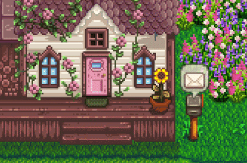

  

  

# 🌻 Hi, welcome to KLIAW Valley!

### 🌱 IT Consultant • Quality Assurance • IT Governance

*Growing ideas, one commit at a time.* 🍓

[🌐 My Portfolio](https://kliaw.github.io/Layung-Aprilia-Portofolio/) · [💼 LinkedIn](https://www.linkedin.com/in/layung-indra-aprilia/)

---

### 🏡 Welcome to My Little Farm!

🌿 IT professional exploring the world of software quality and technology.

🧺 Experienced in Quality Assurance, IT Governance, IT Compliance, and Requirements Analysis.

🪴 Currently growing my skills in testing, technical documentation, and IT consulting.

🌻 Based in Jakarta, Indonesia.

---

### 🎒 My Inventory

| Category | Tools & Skills |
|---|---|
| 🧪 Quality Assurance | Functional Testing, Regression Testing, UAT |
| ⚒️ Testing Tools | Katalon Studio, Postman, JMeter, Jira |
| 📜 IT Governance | IT Compliance, IT Maturity Assessment |
| 🪵 Documentation | Requirements Analysis, Technical Documentation |
| 💻 Other Tools | SQL, Git, GitHub |

---

### 🌱 Current Quests

🍓 Keep learning and improving software quality

🐸 Explore new tools and testing practices

🪴 Build useful and reliable technology solutions

🏡 Grow my professional portfolio

---

### 💌 Let's Be Friends!

[Email](layungiaprilia@gmail.com)

*Thanks for visiting my little corner of GitHub!* 💚

🌻 🐸 🍓 🐓 🌱

