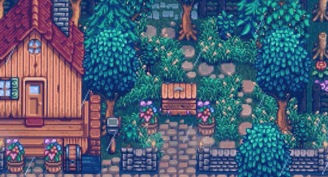
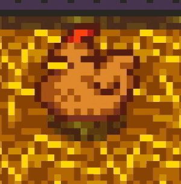
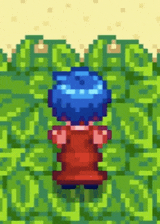

  

  

🍓 *Growing ideas, one commit at a time.* 🍓

[🌐 My Portfolio](https://kliaw.github.io/Layung-Aprilia-Portofolio/) · [💌 Email](layungiaprilia@gmail.com)

---

## 🏡 Welcome to My Little Farm! 🏡

### 🌿 About Me 🌿

IT professional with experience spanning software quality assurance, IT consulting, IT governance and maturity assessment, risk and compliance documentation, and enterprise architecture. Skilled in reviewing business and technical requirements, preparing and executing test scenarios, documenting defects, and supporting governance improvements aligned with frameworks and standards including COBIT 5/2019, ISO/IEC 27001, ISO 22301, and ISO 20000.

📍 Jakarta, Indonesia

  

### 🧺 What I Do 🧺

🌱 Quality Assurance & Software Testing
🌾 IT Governance & Compliance
🪵 Requirements Analysis & Technical Documentation

  <em>🌻 Always learning, growing, and improving one step at a time. 🌻</em>

---

### 🎒 My Inventory 🎒

| Category | Tools & Skills |
|---|---|
| 🧪 Quality Assurance | Functional Testing, Regression Testing, SIT |
| ⚒️ Testing Tools | Jira, Jam |
| 📜 IT Consulting | IT Governance, IT Compliance, IT Maturity Assessment, IT Master Plan, IT Assessment, Enterprise Architecture |
| 🪵 Documentation | Requirements Analysis, Technical Documentation |
| 💻 Other Tools | Microsoft Office, GitHub |

---

### 🪾 Current Quests 🪾

Keep learning and improving software quality

Explore new tools and testing practices

Build useful and reliable technology solutions

Grow my professional portfolio

---

  

### 💌 Let's Be Friends!

[💼 LinkedIn](https://www.linkedin.com/in/layung-indra-aprilia/)

*Thanks for visiting my little corner of GitHub!* 💚

🌻 🐸 🍓 🐓 🌱

